# Boîtier à boisson pour simracing

Un boîtier avec une bouteille d'eau, une petite pompe et un tuyau qui arrive à la bouche. Tant que tu appuies sur le bouton, l'eau arrive. Le bouton peut être sur le boîtier ou sur le volant, via SimHub.

## Fichiers

| Fichier | Rôle |
| --- | --- |
| [`boitier_boisson.ino`](boitier_boisson.ino) | Programme de l'Uno, aucune bibliothèque |
| [`../simhub/boisson_message.js`](../simhub/boisson_message.js) | Formule SimHub pour boire avec un bouton du volant (facultatif) |

## Matériel

| Pièce | Conseil |
| --- | --- |
| Arduino Uno Rev3 ou Nano | Une carte à part, ou celle du tendeur si tu fusionnes les programmes plus tard |
| Pompe péristaltique 12 V, 50 à 100 ml/min | Le liquide ne touche que le tuyau : propre, pas de goutte à l'arrêt, débit doux. Évite les pompes d'aquarium immergées |
| Module MOSFET « logic level » (D4184, AOD4184 ou IRLZ44N) | Pas le module IRF520 : il ne s'ouvre pas bien avec les 5 V de l'Uno |
| Diode 1N4007 ou 1N5819 | Aux bornes de la pompe, si le module n'en a pas |
| Alimentation 12 V 1 A, jack 5,5 × 2,1 mm | Alimente la pompe et l'Uno |
| Tuyau silicone alimentaire, environ 1 m | Diamètre intérieur adapté aux embouts de la pompe (souvent 3 ou 4 mm) |
| Embout à mordre (valve type poche à eau de randonnée) | Empêche les gouttes et se nettoie facilement |
| Bouteille avec bouchon percé, ou poche à eau | Percer un deuxième petit trou dans le bouchon pour laisser entrer l'air |
| Bouton d'arcade ou bouton poussoir | Entre D2 et GND |
| Boîtier | Imprimé en 3D ou boîte de dérivation, l'électronique **au-dessus** de l'eau |

## Câblage

| De | Vers | Remarque |
| --- | --- | --- |
| Alimentation 12 V | Jack de l'Uno | |
| Broche Vin de l'Uno | Entrée + (VIN) du module MOSFET | Le 12 V du jack ressort sur Vin |
| GND de l'Uno | Entrée − (GND) du module MOSFET | Masse commune |
| D9 de l'Uno | SIG (ou IN) du module MOSFET | |
| Sortie V+ / V− du module | Fils + / − de la pompe | Si l'eau part dans le mauvais sens, inverse les deux fils |
| Diode | Aux bornes de la pompe, bande côté + | Protège le MOSFET |
| Bouton | Entre D2 et GND | |
| USB | Uno → PC | Seulement pour le bouton du volant via SimHub |

## Montage du boîtier

1. Fixe l'Uno, le module et la pompe dans la partie haute du boîtier.
2. Mets la bouteille en bas. Perce le bouchon de deux trous : un pour le tuyau, qui descend jusqu'au fond, et un petit pour l'air.
3. Fais sortir le tuyau par le haut du boîtier, attache-le à l'arceau ou au casque avec une pince, et mets l'embout à mordre au bout.
4. Place le bouton sur le dessus du boîtier, ou utilise un bouton du volant (étape 3).

## 1. Installer le programme

1. Branche l'Uno au PC, choisis **Arduino Uno** et son port dans Arduino IDE 2.
2. Ouvre `boitier_boisson.ino` et clique sur **Téléverser**.

## 2. Premier essai

1. Remplis la bouteille, pose le bout du tuyau dans un verre.
2. Appuie sur le bouton : la LED de l'Uno s'allume et la pompe tourne.
3. Le tuyau met quelques secondes à se remplir la première fois. Si la pompe s'arrête avant, relâche et rappuie : chaque appui dure au plus 4 s.
4. Mesure ce qui sort en 4 s. Règle ensuite :

| Réglage | Effet |
| --- | --- |
| `DOSE_MAX_MS` | Durée maximale d'une gorgée (4 s par défaut) |
| `PAUSE_MS` | Pause obligatoire entre deux gorgées (1 s) |
| `PUISSANCE` | Débit : 255 = plein, vers 150 pour plus doux |
| `AMORCAGE_MS` | Remplit le tuyau tout seul au démarrage (0 = désactivé) |

## 3. Bouton du volant via SimHub (facultatif)

1. **Custom serial devices** › **Add new serial device**, port de l'Uno, **115200** bauds. Ça peut être le même SimHub que pour le tendeur et la matrice, avec un appareil de plus.
2. **Update messages** › **Add new message** › coche **Use JavaScript** et colle `simhub/boisson_message.js`.
3. Appuie sur le bouton du volant, repère sa propriété dans **Available properties** (`JoystickPlugin.…_B05` par exemple) et mets-la dans `BOUTON`.

Si SimHub se ferme ou si le câble se débranche, la pompe s'arrête en moins d'une demi-seconde. Le bouton du boîtier marche toujours, même sans PC.

## Sécurité et hygiène

- **Petites gorgées** : le programme coupe la pompe après 4 s même si le bouton reste coincé. Ne monte pas `DOSE_MAX_MS` trop haut, surtout avec une pompe à gros débit.
- **Eau seulement**, ou boisson sans sucre : le sucre colle dans le tuyau et fait des moisissures.
- **Vide et rince** la bouteille et le tuyau après chaque session ; une fois par semaine, fais passer de l'eau chaude avec un peu de bicarbonate, puis rince bien.
- **L'électronique au-dessus de l'eau**, jamais dessous ; une fuite ne doit pas tomber sur l'Uno ni sur l'alimentation.
- **Pompe péristaltique** : quand elle est arrêtée, elle bloque le tuyau, donc pas de siphon même si la bouteille est plus haute que ta bouche.

## Dépannage

| Symptôme | Solution |
| --- | --- |
| La pompe ne tourne pas, la LED s'allume | Module MOSFET non « logic level », ou 12 V absent sur le module |
| La pompe tourne mais rien ne sort | Sens inversé : échange les fils de la pompe ; ou bouchon sans trou d'air |
| L'eau coule toute seule | Ajoute l'embout à mordre ; vérifie que c'est bien une pompe péristaltique |
| L'Uno redémarre quand la pompe démarre | Diode manquante, ou alimentation trop faible |
| Le bouton du volant ne fait rien | Vérifie le nom de la propriété dans `BOUTON` et que l'appareil est activé dans SimHub |

## Message série

SimHub envoie `B1,<nombre>` tant que le bouton est appuyé, `B0,<nombre>` sinon, suivi d'un saut de ligne, à 115200 bauds. Le nombre change à chaque envoi pour que SimHub renvoie le message en continu. Sans message pendant 0,5 s, le bouton du volant est considéré comme relâché.
