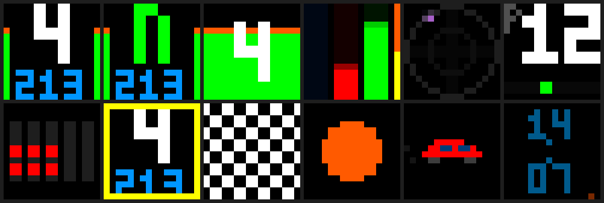

# Matrice LED 16 × 16 pour SimHub

Une matrice WS2812B de 256 LED, pilotée par une Arduino Uno Rev3 (ou une Nano) et SimHub. SimHub envoie la télémétrie du jeu, l'Arduino dessine tout : jauge de régime, rapport, pédales, cercle de G, position, drapeaux, feux de départ, animation de fin de tour et horloge hors jeu.

## Fichiers

| Fichier | Rôle |
| --- | --- |
| [`matrice_led_16x16.ino`](matrice_led_16x16.ino) | Programme de l'Arduino (bibliothèque FastLED) |
| [`../simhub/matrice_message.js`](../simhub/matrice_message.js) | Formule JavaScript pour SimHub › Custom serial devices › Update messages |

## Matériel

- Arduino Uno Rev3 ou Nano. **Pas la même carte que le tendeur de filets** : l'affichage de la matrice bloque les interruptions et ferait trembler les servos.
- Matrice WS2812B 16 × 16
- Alimentation 5 V, 3 A minimum (4 A conseillé)
- Condensateur 1000 µF, 10 V ou plus
- Résistance 330 à 470 Ω
- Bouton poussoir (facultatif) pour changer d'écran

L'Uno sort du 5 V sur ses broches : pas besoin de convertisseur de niveau, contrairement à un ESP32.

## Câblage

| De | Vers | Remarque |
| --- | --- | --- |
| Alim 5 V + | Fil rouge (5 V) de la matrice | Jamais depuis la broche 5 V de l'Uno |
| Alim 5 V − | Fil blanc ou noir (GND) de la matrice | |
| GND de l'Uno | GND de la matrice | Masse commune obligatoire |
| D6 de l'Uno | Résistance 330–470 Ω, puis DIN de la matrice | Côté flèche d'entrée, pas DOUT |
| Condensateur 1000 µF | Entre 5 V et GND, au plus près de la matrice | Patte − (bande) sur GND |
| Bouton (facultatif) | Entre D2 et GND | Change d'écran |
| USB | Uno → PC | Données SimHub |

Le programme limite la luminosité à environ 15 % (`LUMINOSITE = 40`) et le courant à 2 A (`COURANT_MAX_MA`). Si ton alimentation est plus petite, baisse `COURANT_MAX_MA`.

## 1. Installer le programme

1. Arduino IDE 2 › **Outils › Gérer les bibliothèques**, cherche **FastLED** et installe-la.
2. Branche l'Uno seule au PC, choisis **Arduino Uno** et son port COM.
3. Ouvre `matrice_led_16x16.ino` et clique sur **Téléverser**.

## 2. Vérifier le sens de la matrice

Au démarrage, la matrice allume trois coins pendant 2 secondes, avec une petite diagonale blanche partant du coin rouge :

| Coin | Doit être |
| --- | --- |
| Rouge | En haut à gauche |
| Vert | En haut à droite |
| Bleu | En bas à gauche |

Si ce n'est pas le cas, change ces réglages en haut du programme, un par un, et téléverse à nouveau :

| Symptôme | Réglage |
| --- | --- |
| Image en dents de scie, une ligne sur deux décalée | `SERPENTIN` (inverse sa valeur) |
| Rouge et vert inversés | `MIROIR_X = true` |
| Rouge et bleu inversés | `MIROIR_Y = true` |
| Vert et bleu inversés | `ECHANGER_XY = true` |

## 3. Configurer SimHub

1. **Add/remove features** › coche **Custom serial devices**.
2. **Custom serial devices** › **Add new serial device**, port de l'Arduino, **115200** bauds, active l'appareil.
3. **Update messages** › **Add new message** › coche **Use JavaScript** et colle `simhub/matrice_message.js`.
4. Pour changer d'écran avec un bouton du volant : appuie sur le bouton, repère sa propriété dans **Available properties** (`JoystickPlugin.…_B05` par exemple) et mets-la dans `BOUTON_ECRAN`. Sinon, utilise le bouton sur D2.
5. Comme pour le tendeur, regarde `AccelerationSurge` dans **Available properties** : vers −10 à −30 au freinage, garde `UNITE = 9.81` ; vers −1 à −3, mets `UNITE = 1`.

Quand SimHub se connecte, l'Arduino redémarre et montre les trois coins : c'est normal.

## Les écrans

| N° | Écran | Contenu |
| --- | --- | --- |
| 0 | Tableau | Régime sur les colonnes de gauche et de droite, rapport en gros, vitesse en km/h |
| 1 | Régime | Jauge plein écran qui monte ligne par ligne, rapport par-dessus |
| 2 | Pédales | Embrayage (bleu), frein (rouge), accélérateur (vert) ; colonne de droite : ABS en haut, antipatinage en bas, qui clignotent quand ils interviennent |
| 3 | G | Point sur deux cercles (1 G et 2 G) avec une traînée. Freinage : le point monte. Virage à droite : il part à gauche |
| 4 | Position | P1 en or, P2 en argent, P3 en bronze ; en bas, l'écart au meilleur tour (vert à gauche si tu gagnes du temps, rouge à droite si tu en perds, barre pleine = 1 s) |

La jauge passe du vert à l'orange à 70 %, au rouge à 88 % (`SEUIL_ORANGE`, `SEUIL_ROUGE` dans le programme), et clignote en rouge à partir de 96 % du régime max (`SEUIL_SHIFT` dans SimHub).

## Par-dessus les écrans

| Événement | Affichage |
| --- | --- |
| Drapeau jaune, bleu, blanc, vert, noir, noir à disque orange | Plein écran 3 s, puis simple bordure de la couleur du drapeau tant qu'il est levé |
| Drapeau à damier | Damier qui défile, tant qu'il est levé |
| À l'arrêt sur la grille en course, tour 0 | Cinq feux rouges qui s'allument un par un, une seconde d'écart, et s'éteignent quand la voiture part |
| Fin de tour | Une voiture traverse l'écran ; si c'est ton meilleur tour, flash violet |
| Pas de jeu lancé | Horloge, avec un point qui fait le tour de l'écran comme une trotteuse |
| SimHub fermé | Un point bleu qui tourne lentement |

Les feux de départ ne sont pas synchronisés avec ceux du jeu : SimHub ne donne pas cette information de façon commune à tous les jeux. Ils montrent que tu es sur la grille, et s'éteignent quand tu démarres. Pour les couper : `DEPART_ACTIF = false`.

Tous les jeux ne remontent pas tous les drapeaux ni le delta au meilleur tour : ce qui manque reste simplement éteint.

## Dépannage

| Symptôme | Solution |
| --- | --- |
| Rien ne s'allume | DIN et non DOUT, masse commune entre l'alim et l'Uno, alimentation branchée |
| Premières LED de mauvaise couleur ou qui scintillent | Résistance sur la ligne de données, fil de données court |
| Couleurs fausses (rouge affiché en vert) | Remplace `GRB` par `RGB` dans `FastLED.addLeds` |
| L'Uno redémarre quand l'écran devient clair | Matrice alimentée par l'Uno : utilise une alimentation séparée |
| Téléversement impossible, port occupé | Désactive l'appareil dans SimHub |
| L'affichage saute ou se fige par moments | Les messages trop rapprochés se perdent pendant l'affichage : baisse la fréquence d'envoi du message dans SimHub si ta version le permet |
| Le point G part du mauvais côté | `INVERSER_VIRAGE = true` dans SimHub |

## Message série

SimHub envoie `$` suivi de 22 nombres séparés par des virgules, puis `*` et la somme des codes des caractères entre `$` et `*` (modulo 256), puis un saut de ligne, à 115200 bauds. L'ordre des nombres est celui de l'énumération `Champ` du programme. Une ligne abîmée est ignorée ; sans message pendant 3 s, la matrice passe en veille.
